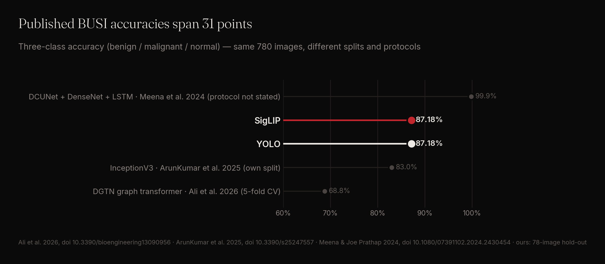
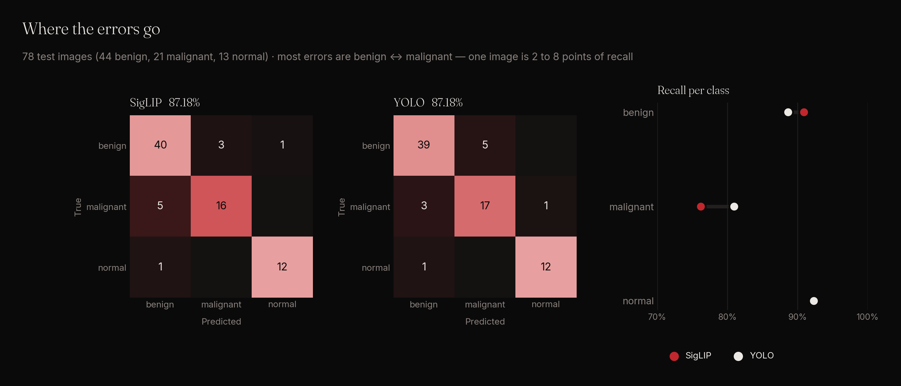
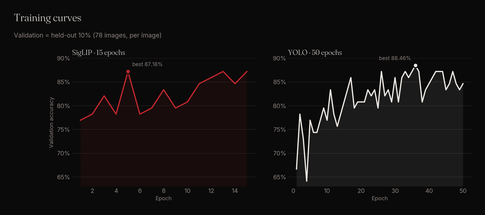

# Breast ultrasound classification on BUSI — and why its leaderboard is unreliable

Two image classifiers, YOLO and SigLIP, were trained with one fixed recipe, **without dataset-specific tuning**, on BUSI — 780 breast ultrasound images labelled benign, malignant or normal — and tested on a held-out set of 78 images.

**Result: 87.18 % accuracy for both models (macro F1 87.01 % YOLO, 87.07 % SigLIP).** On this dataset the more useful finding is how little a single BUSI number means: published accuracies on the same 780 images range from 68.8 % to 99.86 %.

| Model | Accuracy | Macro F1 | Balanced accuracy |
|---|---|---|---|
| **YOLO** (ours) | 87.18 % | 87.01 % | 87.30 % |
| **SigLIP** (ours) | 87.18 % | 87.07 % | 86.47 % |

---

## Try it

| | |
|---|---|
| **Live demo** | [busi-breast-ultrasound.streamlit.app](https://busi-breast-ultrasound.streamlit.app) — upload a breast ultrasound image and watch both models predict, side by side |
| **Model weights** | [SigLIP on Hugging Face](https://huggingface.co/ghostsas001/busi-breast-ultrasound-siglip) · [YOLO on Hugging Face](https://huggingface.co/ghostsas001/busi-breast-ultrasound-yolo) — ready to download, with usage code |

---

## The dataset

BUSI (Al-Dhabyani et al. 2020) contains breast ultrasound images in three classes. No sample images are shown here: the licence of the image files is not stated in the Kaggle release we used.

| Split | Images | benign / malignant / normal |
|---|---|---|
| Train | 624 | 349 / 168 / 107 |
| Validation | 78 | 44 / 21 / 13 |
| Test | 78 | 44 / 21 / 13 |

Stratified 80 / 10 / 10 per image, seed 42. BUSI has no patient identifiers.

---

## The problems with this dataset

### 1. Duplicates and non-breast images

Musah et al. (2025) report that the original BUSI release contains **duplicated images** — some with different annotations — and **non-breast images (maxilla ultrasound scans)**, citing earlier curation work. With duplicates, a random split can place the same image in training and test. Their segmentation results drop when the duplicates are removed, which they attribute to this leakage.

We used the release as is, like most published work. Our numbers can therefore carry the same optimism.

### 2. A tiny test set

78 test images, 13 of them normal: **one image moves a class's recall by 2 to 8 points.** Two runs that differ by three images differ by almost 4 points of accuracy.

### 3. Incomparable protocols

The published results in the figure above use their own random split, five-fold cross-validation, or a protocol the abstract does not state. The 99.86 % result is shown for context only: its protocol could not be checked.

---

## Results in detail

- Both models make 10 errors out of 78, **8 of them between benign and malignant**.
- Normal: 12 / 13 for both.
- YOLO finds more malignant cases (17 / 21 vs 16 / 21); SigLIP more benign ones (40 / 44 vs 39 / 44).

---

## Our approach

| | YOLO | SigLIP |
|---|---|---|
| Training | 50 epochs, 224 px, batch 64 | 15 epochs, lr 5e-5, batch 16 |
| Augmentation | Ultralytics defaults | flips, rotation, sharpness |
| Balancing | none | random oversampling of minority classes |
| Training data | 624 images | same |
| Model selection | best epoch on the validation split | same |

Nothing was tuned on the test set. Training ran on a single NVIDIA T4. The same fixed recipe is used, unchanged, on every dataset we test.

---

## Take-aways

- **Both untuned models land at 87.2 %**, inside the published range and above the two published results whose protocol is stated.
- **A BUSI accuracy on its own is not a ranking**: duplicates, a 78-image test set and different protocols move results by more than any model difference.
- **Benign vs malignant** is where every error that matters sits.

### Limitations

- One training run per model; one 78-image hold-out.
- Duplicates were not removed; the same image may appear in training and test.
- No patient identifiers; no external test set.

---

## References

- Al-Dhabyani W., Gomaa M., Khaled H., Fahmy A. *Dataset of breast ultrasound images.* Data in Brief, 2020. [doi:10.1016/j.dib.2019.104863](https://doi.org/10.1016/j.dib.2019.104863)
- Musah T. et al. *Towards Trustworthy Breast Tumor Segmentation in Ultrasound using Monte Carlo Dropout and Deep Ensembles for Epistemic Uncertainty Estimation.* 2025. [arXiv:2508.17768](https://arxiv.org/abs/2508.17768)
- ArunKumar et al. *Deep Learning for Tumor Segmentation and Multiclass Classification in Breast Ultrasound Images Using Pretrained Models.* Sensors, 2025. [doi:10.3390/s25247557](https://doi.org/10.3390/s25247557)
- Ali et al. *DGTN: Graph-Enhanced Transformer for Multi-Task Breast Ultrasound Tumor Analysis.* Bioengineering, 2026. [doi:10.3390/bioengineering13090956](https://doi.org/10.3390/bioengineering13090956)
- Meena & Joe Prathap. J Biomol Struct Dyn, 2024. [doi:10.1080/07391102.2024.2430454](https://doi.org/10.1080/07391102.2024.2430454)
- Ultralytics YOLO — [docs.ultralytics.com](https://docs.ultralytics.com) · SigLIP (Google) — [huggingface.co/google](https://huggingface.co/google)
